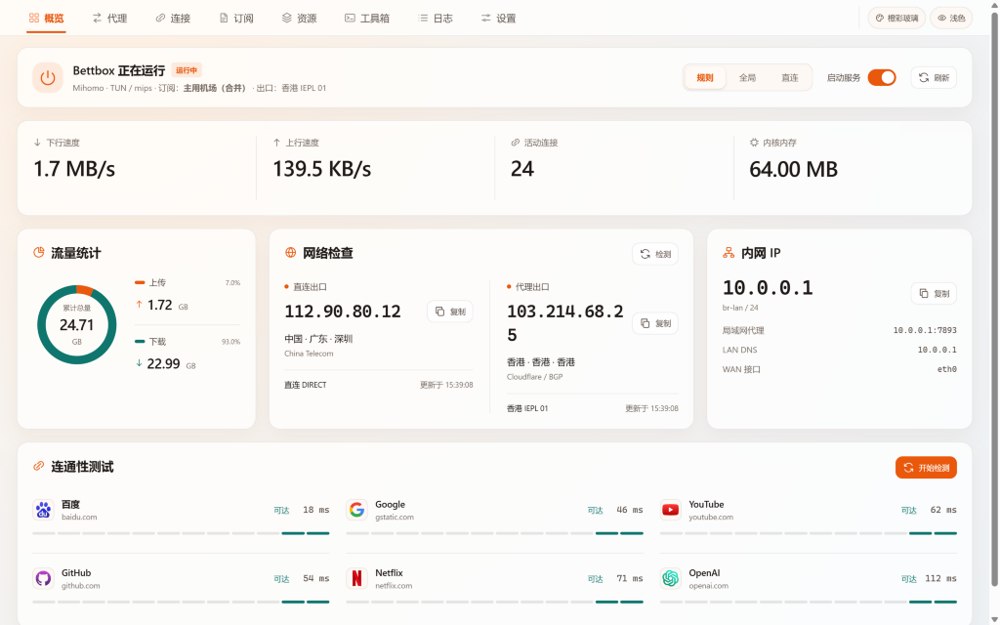
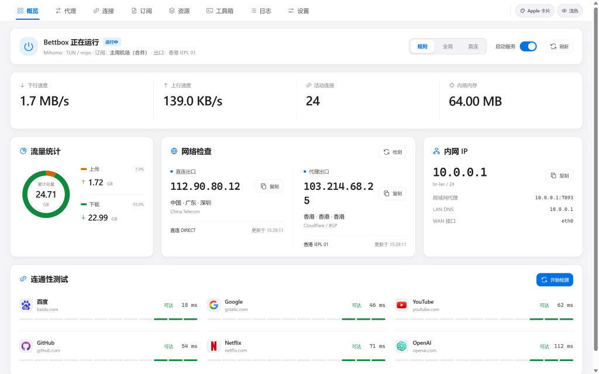
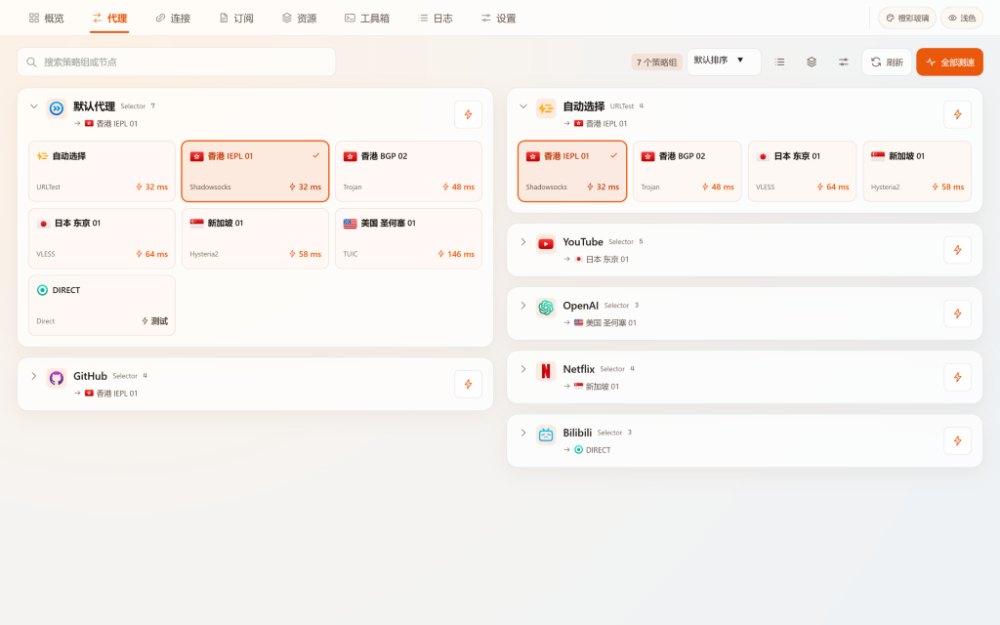
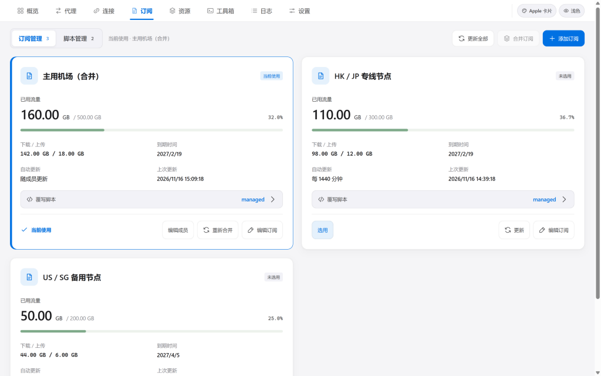

# Bettbox for OpenWrt (`Z_bett`)

将 [Bettbox](https://github.com/appshubcc/Bettbox) 的代理、订阅合并、托管分流与 QuickJS 脚本覆写能力适配到 **OpenWrt 25.12 / ImmortalWrt 25.12**（`apk` 包管理器、ucode LuCI、无 Lua 依赖），提供电脑与手机自适应界面以及 **Meridian 橙彩玻璃 / Apple 清爽卡片 / 跟随宿主主题** 三套外观风格。

| 安装包 | 架构 | 内容 |
|---|---|---|
| `bettbox` | 匹配设备架构 | Mihomo 核心（内嵌订阅合并、路由追踪与流量统计）、`bettbox-forge`（C / QuickJS-NG 脚本引擎）、`procd` 服务、透明代理、配置渲染与工具箱 |
| `luci-app-bettbox` | `all` | 概览、代理、连接、订阅与脚本、资源、工具箱、日志与设置界面及 `rpcd` ucode 后端 |

> 从 `v2026.10.27` 起，`bettbox-forge` 已合入 `bettbox` 安装包，不再单独发布第三个 APK；路由器无需 Rust 或 Python 环境。

---

## 界面预览

<table>
  <tr>
    <td align="center"><b>概览页 · Meridian 橙彩玻璃</b></td>
    <td align="center"><b>概览页 · Apple 清爽卡片</b></td>
  </tr>
  <tr>
    <td></td>
    <td></td>
  </tr>
  <tr>
    <td align="center"><b>代理页 · Qure 图标与延迟测速</b></td>
    <td align="center"><b>订阅与脚本管理 · 合并与用量进度</b></td>
  </tr>
  <tr>
    <td></td>
    <td></td>
  </tr>
</table>

---

## 支持平台与兼容说明

| 构建目标 (`build_target`) | OpenWrt SDK 路径 | 适用设备举例 |
|---|---|---|
| `x86_64` | `targets/x86/64` | 软路由 / x86_64 虚拟机 |
| `aarch64_generic` | `targets/rockchip/armv8` | NanoPi R5C / R5S、Rockchip 等通用 ARM64 |
| `aarch64_cortex-a53` | `targets/mediatek/filogic` | MediaTek Filogic（如小米 AX3000T、红米 AX6000、GL.iNet MT6000 等） |

### 内核与系统依赖注意事项

- **系统要求**：面向 **OpenWrt 25.12** 与使用 `25.12` 版本号的 **ImmortalWrt 25.12**（`apk` 包管理器）。在线与离线 APK 更新接口会检查 `/etc/openwrt_release` 中的 `DISTRIB_RELEASE` 是否属于 `25.12` 系列；若第三方魔改固件使用其他版本号前缀，请手动通过 `apk` 安装。
- **安装前先执行 `apk update`**：`bettbox` 依赖 `firewall4`、`ip-full`、`kmod-tun`、`kmod-nft-tproxy`、`kmod-nft-socket`、`ucode`、`yq`、`curl`、`ca-bundle`、`gzip`、`coreutils-sha256sum`、`unzip`。只要路由器能访问与当前固件匹配的软件源，安装本地 `.apk` 时 `apk` 会**自动补齐**缺失模块。
- **第三方精简 / 自编译固件**：由于 `kmod-*` 内核模块严格绑定编译时的内核 `vermagic`，若固件本身未预装 `kmod-tun` / `kmod-nft-tproxy` / `kmod-nft-socket` 且没有配置配套 `kmods` 源，将无法通过直接安装 `.apk` 满足依赖，需由固件编译方在编包时选入对应模块或直接源码编译 `Z_bett`。

---

## 主要功能

- **透明代理与分流**：支持 TUN、TPROXY、REDIR 透明代理，DNS 接管/真实 IP 域名保护（含 DDNS 回流豁免）、嗅探、QUIC 控制与规则覆写。
- **设备 MAC 控制与设备兜底策略**：
  - 按来源 MAC 设置设备白名单／黑名单（最多 256 项），同时作用于主 LAN 的 IPv4／IPv6 透明代理与 TCP/UDP 53 普通 DNS；启用时 TUN 由插件策略路由接管，兼容升级前的旧 IP／网段条目。
  - 「设置 → 设备兜底策略」可为单独 IPv4／IPv6 或网段指定 `跟随全局 / 直连 / 拒绝 / 指定策略组`，在订阅规则之后、全局 `MATCH` 之前生效，订阅更新后保留。
- **概览、代理与连接**：
  - 实时网速与一分钟趋势线、累计上传/下载环形图、活动连接、内核内存、内网 IP、直连/代理出口及连通性历史探测。
  - 策略组、节点切换、本地 Qure 地区旗帜与服务图标、大节点组分批加载（48 项/批）与搜索、单节点/组/全部延迟测速（默认 60 秒结果复用与共享双并发队列，支持取消排队）。
  - 连接页区分「活动 / 已关闭 / 全部」（随包核心内存保留最近 512 条已关闭连接）。
- **订阅、合并与 QuickJS 脚本引擎**：
  - 支持订阅链接与粘贴导入：完整 Clash YAML 原样保存；分享链接（SS、VMess、VLESS、Trojan、Hysteria2、TUIC、AnyTLS、SOCKS5、HTTP(S)）或 Base64 文本由按需运行的 QuickJS 引擎（`bettbox-forge`）转换并按连接参数去重。
  - 支持合并 2 至 8 份订阅、内置托管分流目录（采用 Bettbox v1.19.8 合并/分流实现），以及可视化提取/切换脚本 `policyGroupOptions`（`main(config, customOptions)`，单次运行限时 10 秒、堆上限 128 MiB、栈 512 KiB）。
  - 渲染时静态校验 DNS 自指向、上游缺失与节点解析策略，遇到 `geosite`/`rule-set` 等离线不可判定规则不推测覆盖。
- **资源更新、备份与网络健康**：
  - Mihomo 核心独立检查更新与回退（保留随包核心与上一选择）；Bettbox / LuCI APK 一键在线更新（核对固定 GitHub 仓库、`bettbox-update.json`、SHA-256、架构与 APK 元数据）及 **上传 APK 离线更新**；下载 GitHub 失败时自动通过本机可用 Mixed 端口重试。
  - 本地与 WebDAV 配置备份/恢复、日志过滤导出、分层只读健康检测（`bettbox health [域名]`）与看门狗（每 300 秒诊断、连续两次控制接口失败才重启且冷却不少于 5 分钟）。
- **Zen 三套外观引擎**：
  - 支持 `Meridian 橙彩玻璃`（默认）、`Apple 清爽卡片`、`跟随宿主主题`（无缝继承 `luci-theme-zen` 等宿主 CSS 变量），配合 `跟随系统 / 浅色 / 深色`，所有样式严格隔离在 `.bb-app` 作用域下。

---

## 安装与升级

从 [Releases](https://github.com/zdabing/Z_bett/releases) 下载匹配设备架构的一组两个 `.apk`（`bettbox` 与 `luci-app-bettbox`），上传到路由器同一目录后先联网刷新源，再先模拟后安装：

```sh
apk update
apk add --simulate --allow-untrusted ./bettbox-[0-9]*.apk ./luci-app-bettbox-[0-9]*.apk bettbox-forge
apk add --allow-untrusted ./bettbox-[0-9]*.apk ./luci-app-bettbox-[0-9]*.apk bettbox-forge
```

- 末尾的 `bettbox-forge` 是新 `bettbox` 包提供的兼容 `provides/replaces` 名称，用于平滑替换早期独立三包版本的依赖约束，并非第三个安装文件。
- 目录中请只保留当前设备架构的一组 APK；项目 APK 未使用官方软件源密钥签名，需保留 `--allow-untrusted`。
- 若已安装 `v2026.10.27` 及以上版本，后续可在 LuCI「资源 → Bettbox 更新」直接一键在线更新，或通过「上传 APK 更新」离线升级；升级前配置备份保存在 `/etc/bettbox/state/before-package-update.tar`。

---

## 构建与发布

### GitHub Actions

- **自动源码校验（`CI`）**：每次推送 `main` 或发起 PR 时自动运行 Shell 语法、`bettbox-forge` C 编译与沙箱行为校验、全量 JS `node --check`、JSON 与 Python 脚本检查。
- **多目标打包与发布（`Build OpenWrt 25 packages`）**：在 Actions 页面手动触发，可选择 `aarch64_generic`（默认）、`aarch64_cortex-a53`、`x86_64` 或 `all`（同时构建全部 3 个架构，共 6 个 `.apk`）；勾选 `publish` 并填写与 `CHANGELOG.md` 对应的 `release_tag`（如 `v2026.11.16`）后，自动校验摘要并发布 Release 与 `bettbox-update.json`。

### OpenWrt 25.12 SDK 本地编译

在对应架构的 OpenWrt 25.12 SDK 中注册本地 feed：

```sh
cp feeds.conf.default feeds.conf
printf '\nsrc-link bettbox /path/to/Z_bett\n' >> feeds.conf
./scripts/feeds update -a
./scripts/feeds install -a
make defconfig
make package/bettbox/compile V=s
make package/luci-app-bettbox/compile V=s
```

如同时开发 `Z_bett` 与 `luci-zen`，可使用 [scripts/build-openwrt-suite.sh](scripts/build-openwrt-suite.sh) 共享 SDK 缓存合编。

### 目录结构

- `bettbox/`：核心包源码（`Makefile`、`patches/`、`upstream/*.go`、`forge/` Rust/QuickJS、`files/` 路由器控制脚本与 UCI 配置）
- `luci-app-bettbox/`：LuCI 前端视图、Scoped CSS、图标资产与 `rpcd` ucode 网关
- `docs/`：架构维护规范（[ARCHITECTURE.md](docs/ARCHITECTURE.md)）与 UI 变量契约（[ZEN-UI-SPEC.md](docs/ZEN-UI-SPEC.md)）
- `.github/`：CI、SDK 多架构构建与发布脚本

---

## 兼容范围与已知限制

- 规则追踪（`trace`）不完整求值 GEO 数据集；NAT 检测依赖可用 UDP 工具；MRS 查询不提供 MMDB 反查。
- `traffic-stats` 流量统计与 `trace` 路由追踪依赖随包核心扩展，若在「资源 → Mihomo 核心」切回上游官方原版核心则不可用；应用维度仅显示路由器本机可识别进程。
- 变更记录见 [CHANGELOG.md](CHANGELOG.md)。

## 许可

本项目采用 **GPL-3.0**；第三方组件及图标许可证见 [LICENSE](LICENSE) 与 `luci-app-bettbox/htdocs/luci-static/resources/bettbox/{flags,qure}/`。
