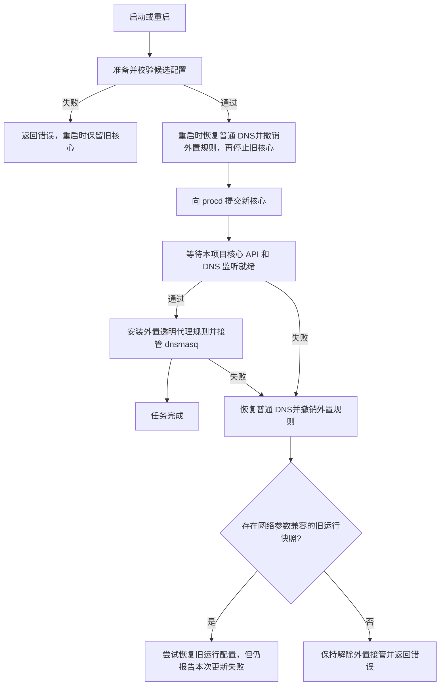

# 启停流程优化（2026-10-27）

本次只修改源码与隔离测试，未编译、未部署、未切换生产网络。此前同步 RPC 有 55 秒命令限时，而校验可耗时更久；init 在提交核心启动前便安装透明代理规则并接管 dnsmasq，重启则先停旧核心再校验。

## 当前流程

- 利用 OpenWrt `rc.common` 的 `service_started` 回调，等 `procd_close_service` 提交实例后再检查就绪；不能在 `start_service` 内等待尚未提交的进程。[OpenWrt 源码](https://github.com/openwrt/openwrt/blob/main/package/base-files/files/etc/rc.common)
- 就绪检查最长约 45 秒，使用系统 uptime，避免系统校时影响截止时间。每次控制器探测最多 1 秒；DNS 要求配置端口的 UDP socket 确实属于本项目 procd/core PID，不能拿其他 DNS 服务的监听当成成功。该检查表示本地监听就绪，不承诺外部 DNS 或节点一定可达。
- `stop_service` 在核心终止前恢复 dnsmasq 并移除本项目外置规则；恢复失败则报错并保留核心，允许重试。没有重拨 WAN、重启 Wi-Fi、执行全局防火墙重启或清空连接跟踪的操作。
- 重启前校验只执行一次；经校验的配置直接用于后续启动，不重复跑整个渲染流程。每次渲染有私有临时目录，只有校验成功后才原子替换运行文件。
- Geo 校验回退仅在 `geodata-mode: true` 时执行一次；复用已捕获的错误输出，移除仅为打印错误而执行的第三次校验。JS 覆写执行增加 60 秒上限，沿用原有的覆写失败回退语义。
- 旧运行配置仅在存在成功启动时保存的网络参数快照、且透明模式、接管方式、控制器地址/密钥、入站端口与 DNS 监听等参数未改变时尝试恢复。参数已改变或第一次升级缺少快照时，不拿新规则套旧核心。回退不撤销用户保存的 UCI 设置，也不保证恢复旧连接。

## 后台任务与权限

`apply` 和 `service_action(start/stop/restart)` 立即返回 `{ok:true,id}`，只表示任务已受理，必须通过 `diagnostic_status` 等到 `done` 再判断成功。`enable/disable` 仍为快速同步调用。概览、设置、订阅应用都使用 `UI.operation` 等待真实结果，兼容没有任务 ID 的旧同步结果；概览在等待期间显示启动/停止状态并禁用开关。

服务任务使用独立的单操作目录锁，不占用三个普通诊断任务配额。已有操作尚未结束时拒绝第二次服务切换。概览不再在任务受理前改写 enabled；后台服务任务负责保存对应的启停意图，避免被拒绝的第二个按钮操作抢改状态。

后台服务任务外层限时 600 秒，浏览器查询预算 630 秒；操作完成即返回，不固定等待这些时间。已完成任务允许下一次操作，遗留锁超过 650 秒可清理。页面查询超时不能当成操作被取消，需刷新服务状态核实。

服务任务不继承普通诊断的 1MB 文件写入限制，避免截断候选配置或 Geo 数据。worker 持续读取命令输出，仅保留末尾最多 1MB 的结果，完成后再上报退出状态。

只有具有写权限的 `apply/service_action` 可以创建服务任务。拥有读取权限的 `diagnostic_start` 仍只允许网络诊断，不接受 `service/core`。新增 `core_update` 写权限接口复用准入锁，核心更新/回退使用 1200 秒预算，见 [核心一键更新](CORE_UPDATE.md)。其他订阅下载、备份等同步 RPC 的限时未在本次全部异步化。

## 外网 NAS 与未解决的边界

TPROXY/REDIR 规则新增 `ct direction reply return`，避免把 NAS 对外网入站连接的回包当作新上网流量接管；正常出站连接的 original 方向仍持续进入透明代理，没有放过所有 established 流量。这不等于已验证端口转发全程无中断。

本项目控制的是外置 nft 规则和 dnsmasq 接管时机。**TUN 的自动路由和 auto-redirect 由 Mihomo 自身在启动过程中管理，可能早于 API/DNS 就绪；本次没有把 TUN 拆成完全独立的两阶段接管。** 核心停止时，经过核心的连接仍可能中断；Fake-IP 客户端缓存可能需要重新解析。长期运行期间的核心崩溃、强制终止后的路由清理，也没有因此获得完整的零中断保证。

没有执行生产路由器的原生 ucode/实际 nft 转发与 procd 启停验收。需要在可恢复的维护窗口，用外部网络持续连接 NAS，分别验证启动、停止、重启、失败回退、IPv4/IPv6、DNS 恢复、WAN 公网地址和已有连接；不能用本地 fixture 的成功替代这些检查。部署时核心脚本、RPC 与 LuCI 组件应一同更新，并刷新页面资源。

## 验证

- `test/service-lifecycle-test.py`：22 项生产 init hook 隔离用例，涵盖顺序、延迟就绪、超时、DNS/防火墙失败、停止失败保留核心、校验失败保留旧核心、无重复校验、兼容快照回退、参数不兼容时解除接管、DNS socket 归属和缺少 IPv6 proc 文件，以及新核心切换的校验顺序和失败恢复。
- `test/shell-regression-test.py`：27 项真实脚本隔离回归，新增无效候选不覆盖运行文件、只在有意义时执行 Geo 回退、已选择独立核心的校验，以及保留入站回包豁免而不旁路整个出站已建立连接。
- `test/core-test.js`：40 项控制器/RPC 回归，包含异步服务/核心更新受理、并发拒绝、失败结果、重试与读取权限不能切换服务或核心。
- `test/overview-exit-test.js`：38 项出口及启停状态用例；`test/service-operation-test.js`：10 项真实共享组件的完成/失败/超时检查。
- `test/diagnostic-worker-test.js`：22 项生产 worker 逻辑的受控执行，验证服务/核心命令、失败状态、参数约束、输出上限与原有诊断分发。服务日志可保留尾部，普通诊断超过上限则报错，避免把截断的数据误报为成功。
- 原有配置渲染/TUN 栈往返、日志和浏览器布局/图标检查通过；shell/JavaScript 语法和 Git 空白检查通过。所有验证均未编译安装包。
